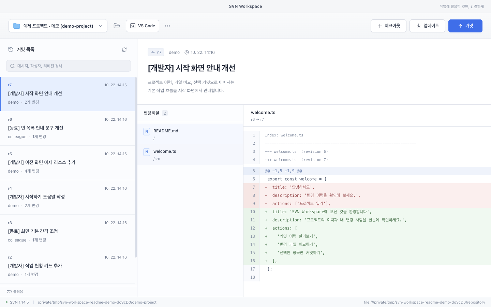
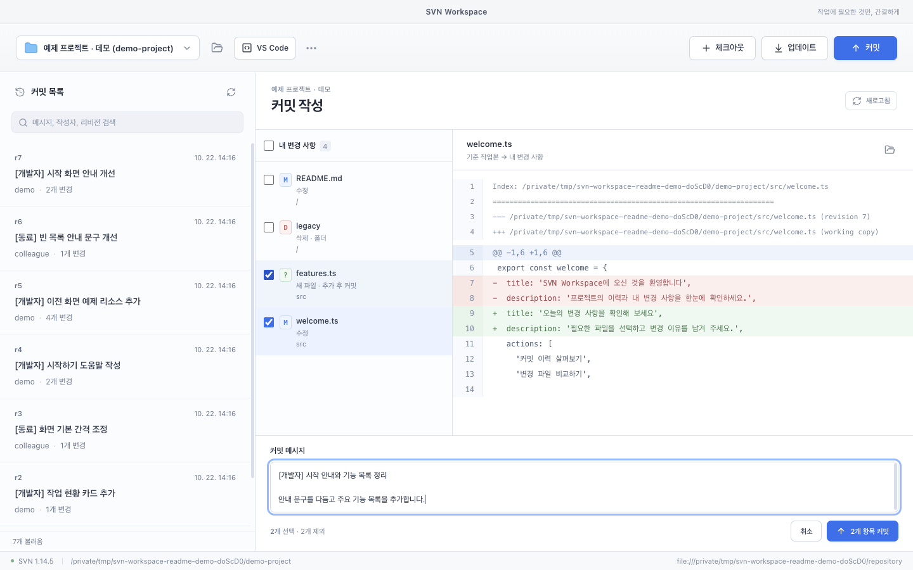
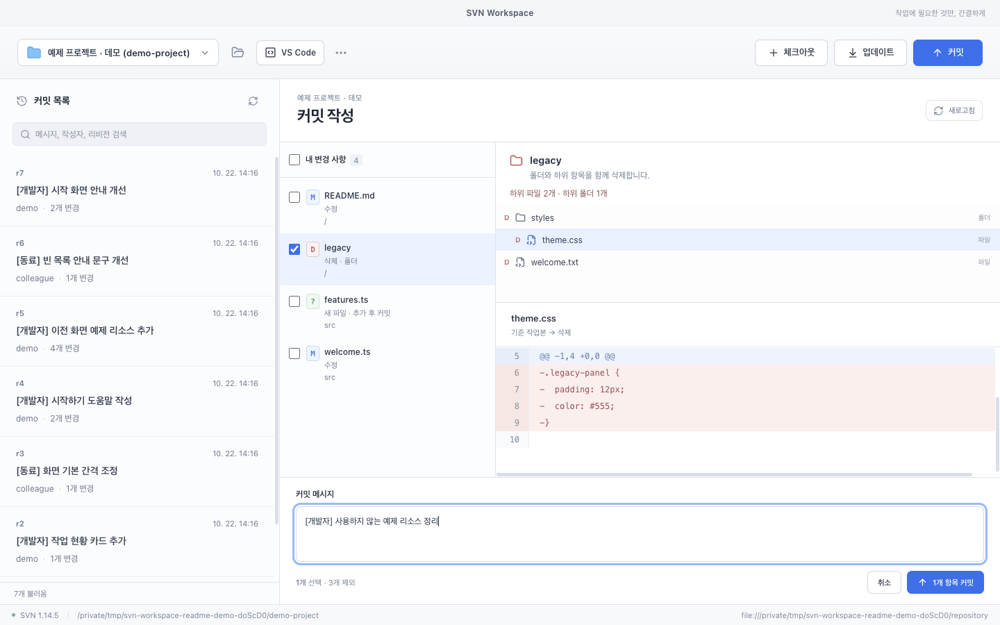
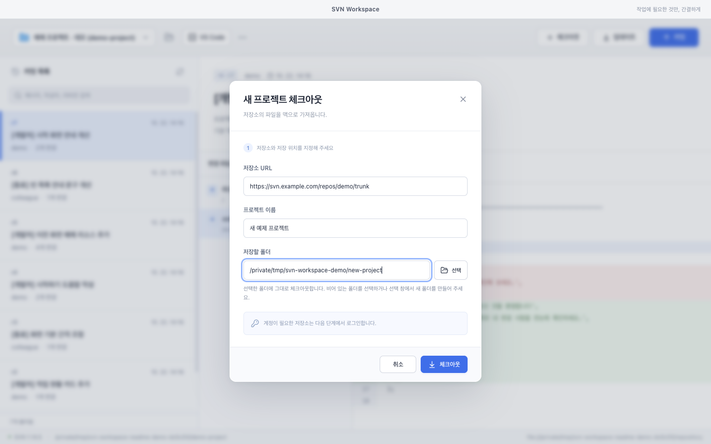
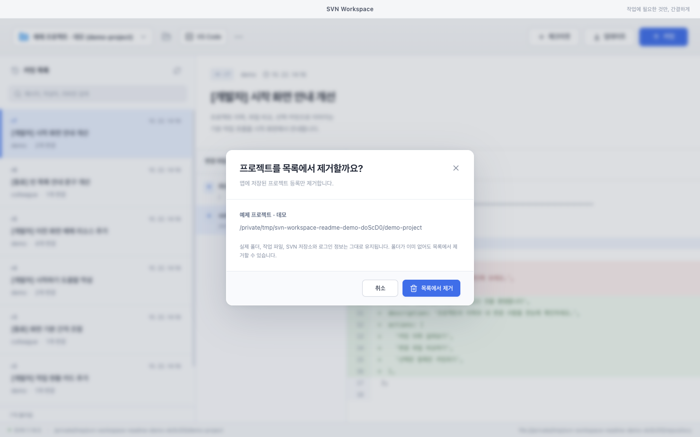

# SVN Workspace

**프로젝트 이력 확인부터 선택 커밋까지, macOS용 SVN 클라이언트.**

SVN Workspace는 체크아웃, 업데이트, 변경 비교, 커밋에 집중한 데스크톱 앱입니다. 왼쪽에서 커밋을 선택하고 오른쪽에서 메시지·변경 파일·텍스트 diff를 확인할 수 있습니다. Electron, React, TypeScript로 만들었으며 맥에 설치된 SVN CLI를 직접 사용합니다. 별도 앱 계정이나 중계 서버는 필요하지 않습니다.

[시작하기](#시작하기) · [사용 가이드](docs/USAGE.md) · [개발 가이드](docs/DEVELOPMENT.md) · [버전 변경 내역](CHANGELOG.md)



> 이 문서의 스크린샷은 실제 앱에 테스트 데이터만 넣어 촬영했습니다. 프로젝트명, 작성자, 저장소 주소와 작업 경로는 모두 예제 데이터입니다.

## 주요 기능

| 기능 | 할 수 있는 일 |
| --- | --- |
| 프로젝트 연결 | 기존 SVN 작업 폴더를 열거나 원하는 폴더로 체크아웃 |
| 커밋 이력 탐색 | 이력 50개씩 불러오기, 불러온 메시지·작성자·리비전 검색 |
| 변경 비교 | 커밋에 포함된 파일과 현재 작업 파일의 텍스트 diff 확인 |
| 선택 커밋 | 수정·추가·삭제할 항목을 골라 커밋하고 나머지 변경은 유지 |
| 폴더 삭제 확인 | 함께 삭제될 하위 항목과 파일 내용을 확인한 뒤 커밋 |
| 업데이트·충돌 처리 | 서버 변경 받기, 충돌 파일 확인 및 수동 수정 후 해결 표시 |
| 프로젝트 관리 | 여러 프로젝트 전환, 표시 이름 변경, 목록에서 등록 제거 |
| 편집기 연결 | 현재 프로젝트를 VS Code에서 열기 |
| 저장소 로그인 | SVN 계정으로 인증하고 필요할 때 비밀번호를 암호화해 저장 |

## 대표 기능

### 이력과 변경 내용을 한 화면에서

커밋 목록에서 항목을 고르면 작성자, 메시지, 변경 파일이 표시됩니다. 파일을 선택해 이전 리비전과의 차이를 확인하고, 목록 경계를 드래그해 작업에 맞는 너비로 조절할 수 있습니다. 검색은 현재 불러온 이력을 대상으로 합니다.

### 필요한 변경만 골라 커밋

커밋 화면에서 파일별 diff를 살펴보고 보낼 항목만 체크합니다. 새 파일은 커밋 시 추가되며, 선택하지 않은 수정 파일과 새 파일은 작업 폴더에 남습니다.



### 폴더 삭제 범위를 확인하고 커밋

삭제·누락된 폴더를 선택하면 함께 삭제될 하위 파일·폴더와 개수를 표시합니다. 하위 파일을 누르면 삭제되는 내용을 볼 수 있고, 커밋 직전에는 삭제 범위를 한 번 더 확인합니다.



### 프로젝트 연결과 목록 관리

체크아웃은 선택한 폴더를 그대로 사용합니다. 프로젝트의 표시 이름을 바꾸거나 목록에서 제거할 수 있으며, 등록 제거 시 실제 파일·폴더·저장소와 로그인 정보는 유지됩니다.

<details>
<summary>체크아웃·프로젝트 관리 화면 보기</summary>

**새 프로젝트 체크아웃**



**프로젝트 목록에서 제거**



</details>

## 시작하기

macOS와 별도로 설치한 Subversion CLI가 필요합니다. 개발 실행에는 Node.js **22.12 이상**과 npm을 사용합니다. 설치 패키지는 Apple Silicon(arm64)을 대상으로 구성되어 있습니다.

저장소를 내려받은 뒤 프로젝트 루트에서 실행합니다.

```sh
npm ci
npm run dev
```

앱을 실행한 다음 다음 순서로 사용합니다.

1. **기존 폴더 열기**로 SVN 작업 폴더를 연결하거나 **체크아웃**으로 새로 받습니다.
2. 커밋 목록에서 이력과 파일별 변경 내용을 확인합니다.
3. **업데이트**로 최신 변경을 받거나 **커밋**에서 보낼 항목과 메시지를 선택합니다.

SVN 실행 파일을 찾지 못하면 시작 화면의 **SVN 실행 파일 선택**으로 직접 지정할 수 있습니다. 로그인·프로젝트 관리·충돌 처리의 상세 절차는 [사용 가이드](docs/USAGE.md)를 참고하세요.

### 예제 프로젝트로 체험하기

업무 저장소 없이 로컬 예제 저장소와 작업 폴더를 만들 수 있습니다.

```sh
node scripts/create-demo.mjs work/demo
```

생성된 `work/demo/workspace`를 앱에서 열어 이력 조회와 변경 비교를 체험하세요. 대상 디렉터리는 새 경로여야 합니다. 명령 경로 설정과 예제 구성은 [개발 가이드](docs/DEVELOPMENT.md#예제-저장소)에서 확인할 수 있습니다.

## 지원 범위

- diff는 텍스트 중심이며 바이너리 비교는 지원하지 않습니다.
- 폴더는 삭제·누락 상태의 커밋을 지원합니다. 폴더 자체의 신규 추가·속성 변경은 직접 선택할 수 없습니다.
- revert, cleanup, branch/tag, merge, 트리 충돌 해결 UI는 제공하지 않습니다.
- 작업 취소는 실행 중인 프로세스를 중단합니다. 이미 적용된 파일 변경이나 완료된 커밋을 되돌리지는 않습니다.
- SVN 실행 파일은 앱에 포함하지 않으며 Apple Developer 서명·공증은 구성하지 않았습니다.

## 문서

| 문서 | 내용 |
| --- | --- |
| [사용 가이드](docs/USAGE.md) | 프로젝트 연결, 로그인, 이력, 선택 커밋, 충돌 처리와 제약 |
| [개발 가이드](docs/DEVELOPMENT.md) | 실행 환경, 예제 데이터, 테스트, 패키징과 코드 구성 |
| [버전 변경 내역](CHANGELOG.md) | 버전별 기능 추가·개선·수정 사항 |
